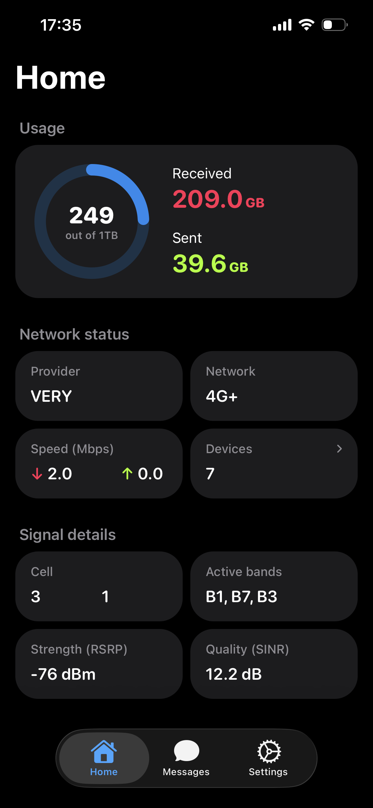
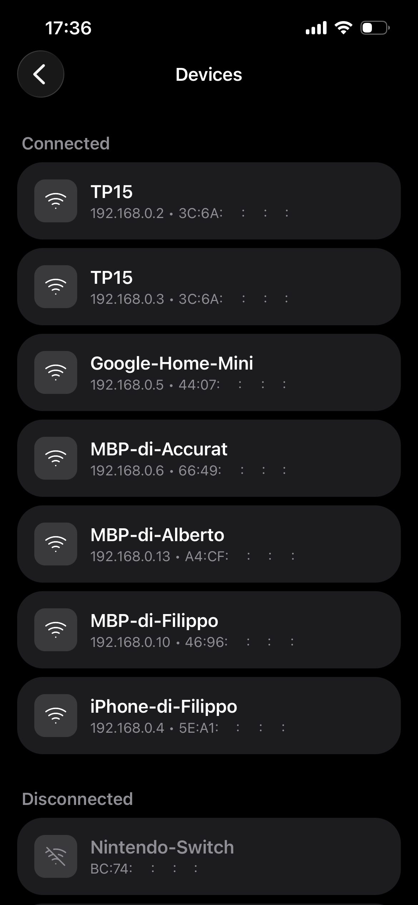
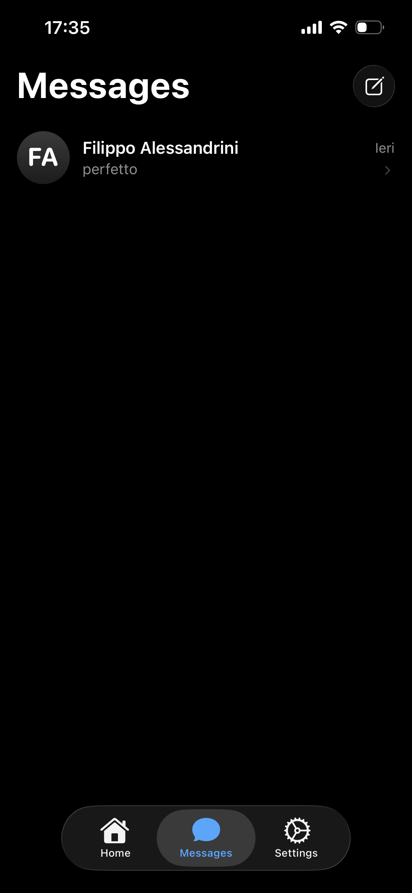
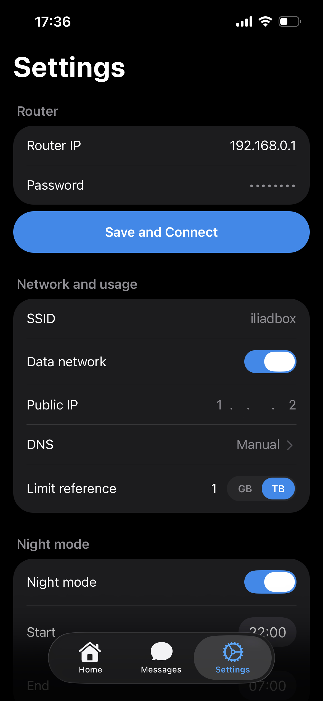
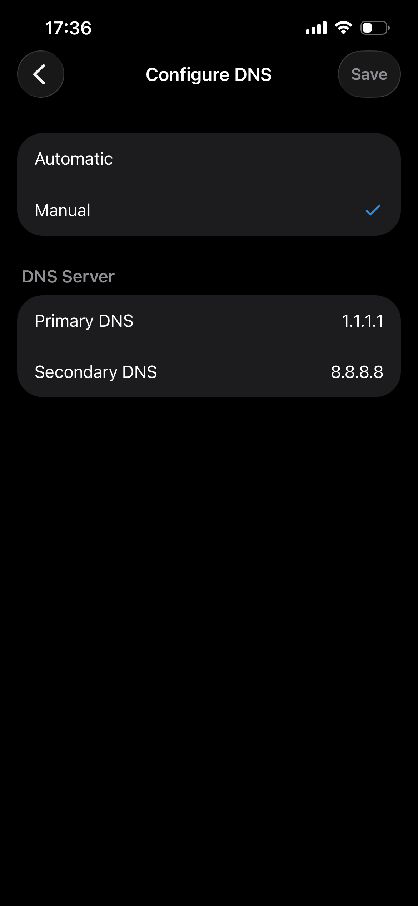

# Routy

Routy is a native client for ZTE routers, for iPhone and Mac. It manages SMS messages and monitors the router directly, without using the router's web interface.

## Overview

The app connects to the ZTE router over the local network using its internal `goform` API. It provides a native messaging experience, background checks for new messages, a real-time dashboard for network statistics and settings such as manual DNS, LTE bands, device management and Night Mode.

## Key Features

- **SMS Management**: read, send and delete SMS messages, with conversations that open on the latest message.
- **Background Monitoring**: periodic background checks for new messages, with local notifications.
- **Network Dashboard**: signal strength (RSRP/SINR), active bands (Carrier Aggregation support), connected cell ID and network status.
- **Data Tracking**: monthly data usage and real-time throughput.
- **Device Management**: connected and disconnected devices, with custom names and icons, blocking and forgetting.
- **Router Settings**: Wi-Fi names, mobile data, DNS, LTE bands, Night Mode and reboot.
- **Demo Mode**: address `demo`, password `demo`, to try the app without a router.
- **Privacy Focused**: every communication happens between your device and the router: nothing leaves your network, and the router's password stays on the device (in the Keychain on iPhone, in the app's sandbox container on Mac).

## Tech Stack

- SwiftUI and Swift 6, iOS 26, no third-party dependencies.
- `@Observable` state, actors for the router client and notifications.
- `BackgroundTasks` and `UserNotifications` for SMS notifications, `Contacts` for names.

## Requirements

- A compatible ZTE router (only tested on MF289F).
- The iPhone must be connected to the router's Wi-Fi network, with Local Network permission granted.
- iOS 26, or macOS 26 on a Mac with Apple silicon.
- Xcode 26 or later to build.

## Build

Open `Routy.xcodeproj` in Xcode and run the `Routy` scheme on your iPhone. Choose the Release configuration for everyday use.

The bundle ID is `com.filippoalessandrini.routy`, the same as the Expo app it replaces, so it installs as an update. On first launch `LegacyStorage` moves what the Expo app kept in AsyncStorage: the password to the Keychain, everything else to `UserDefaults`, then deletes those files, which held the password in plain text. The Expo app's last version is tagged `expo-final`.

## Mac

The same code builds a Mac app with Mac Catalyst. It's signed only for the Mac that builds it, with no Apple profile, so it never expires. Build it and copy it to Applications:

```bash
xcodebuild -project Routy.xcodeproj -scheme Routy -configuration Release -destination 'platform=macOS,arch=arm64,variant=Mac Catalyst' -derivedDataPath build/catalyst build
```

```bash
ditto build/catalyst/Build/Products/Release-maccatalyst/Routy.app /Applications/Routy.app
```

On the Mac the router password is kept in a file inside the app's sandbox container rather than in the Keychain, which refuses apps without an Apple profile. There's no background refresh: while the app is open, even in the background, it checks for new SMS every 30 seconds.

If it can't reach the router, allow it in System Settings → Privacy & Security → Local Network (turn it off and on if it's already allowed): macOS may keep the decision it took for an earlier build, without asking again.

## Structure

| Folder | Contents |
|---|---|
| `Routy/App` | Entry point and window, tabs, navigation |
| `Routy/DesignSystem` | Tokens and reusable components. Rules are in [DESIGN.md](DESIGN.md) |
| `Routy/Router` | The `goform` client, the demo client, parsing, parameter encoding, models |
| `Routy/Logic` | Text shown on screen, device icons |
| `Routy/Store` | App state, preferences, Keychain, migration from the Expo app |
| `Routy/Services` | Contacts, SMS notifications, background refresh |
| `Routy/Screens` | Home, Messages, Chat, New message, Devices, Settings, DNS, LTE bands |
| `RoutyTests` | Router layer parity and fixed bugs |

## Tests

`RoutyTests/golden.json` holds what the Expo app returned for fixed inputs: hashes, UCS2, dates, conversations, router data, the fields of every write command and how parameters are encoded. It's a frozen reference: the native router layer must keep returning the same.

```bash
xcodebuild -project Routy.xcodeproj -scheme Routy -destination 'platform=iOS Simulator,name=iPhone 17 Pro' test
```

## Translations

English and Italian, in `Routy/Resources/Localizable.xcstrings` and `InfoPlist.xcstrings`. Edit them in Xcode.

## On the router

Things the simulator can't check, to try with the real router:

- Sending an SMS to a `+39…` number, renaming a device with spaces in its name, blocking and unblocking, separate 2.4GHz and 5GHz Wi-Fi names, DNS, bands and Night Mode.
- Logging into the router's web dashboard while the app is open: the app should log in again on its own.
- The throughput unit: the app shows `realtime_*_thrpt / 1024` as "Kbps", as the Expo app did. Other ZTE clients read the value as bytes per second, in which case the speed is about 8 times higher. Compare once with a speed test; the conversion is in `Formatting.speed`.
- Background notifications: in Xcode, pause the app and run `e -l objc -- (void)[[BGTaskScheduler sharedScheduler] _simulateLaunchForTaskWithIdentifier:@"com.filippoalessandrini.routy.refresh"]`, then resume.

## Screenshots

<div align="center" style="display: flex; flex-wrap: wrap; justify-content: center; gap: 2%; width: 100%;">
  
  
  
  
  
  
</div>

---

_Note: This is a third-party application and is not affiliated with ZTE Corporation._
